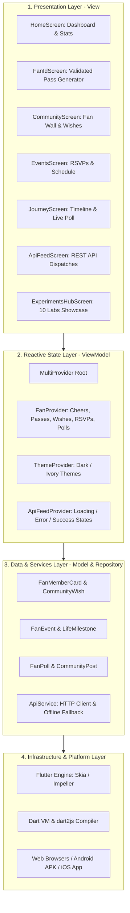

# PROJECT REPORT
## RATHNAVERI KAVITHA OFFICIAL FAN PAGE & COMMUNITY HUB
### A Responsive Cross-Platform Flutter Application Integrating Advanced State Management, REST API Networking, and 10 Academic Laboratory Curriculum Experiments

---

**Submitted in partial fulfillment of the requirements for the award of the degree of**  
**BACHELOR OF TECHNOLOGY**  
**in**  
**COMPUTER SCIENCE & ENGINEERING**  

**By:**  
**Sriram Kavadi & Team**  
**Roll No(s):** 22AG1A05XX  
**Department & Year:** Department of Computer Science & Engineering, III Year B.Tech  
**Academic Year:** 2025 – 2026  
**Duration:** 21st October 2026 to 27th October 2026 (1-Week Vacation Internship Project)  

**Under the Internal Guidance & Mentorship of:**  
**Dr. / Prof. Faculty Mentor**, Associate Professor  
Department of Computer Science & Engineering  

**Institution:**  
**ACE Engineering College (Autonomous)**  
*(Approved by AICTE, Affiliated to JNTUH, Accredited by NBA & NAAC with 'A+' Grade)*  
Ankushapur, Ghatkesar Mandal, Medchal-Malkajgiri District, Hyderabad, Telangana – 501301  

---

## CERTIFICATE

This is to certify that the technical project report titled **"RATHNAVERI KAVITHA OFFICIAL FAN PAGE & COMMUNITY HUB: A RESPONSIVE FLUTTER APPLICATION INTEGRATING ADVANCED STATE MANAGEMENT, REST API, AND EXPERIMENTAL LAB CURRICULUM"** is a bona fide record of independent project work carried out by **Sriram Kavadi & Team** (Roll No: **22AG1A05XX**), student(s) of **Department of Computer Science & Engineering, III Year B.Tech**, under our direct supervision and guidance during the vacation period from **21st October 2026 to 27th October 2026**.

The results embodied in this report have not been submitted to any other University, Institute, or Board for the award of any degree or diploma.

  

----------------------------------------- &nbsp;&nbsp;&nbsp;&nbsp;&nbsp;&nbsp;&nbsp;&nbsp;&nbsp;&nbsp;&nbsp;&nbsp;&nbsp;&nbsp;&nbsp;&nbsp;&nbsp;&nbsp;&nbsp;&nbsp;&nbsp;&nbsp;&nbsp;&nbsp;&nbsp;&nbsp;&nbsp;&nbsp;&nbsp;&nbsp;&nbsp;&nbsp;&nbsp;&nbsp;&nbsp;&nbsp;&nbsp;&nbsp;&nbsp;&nbsp;&nbsp;&nbsp;&nbsp;&nbsp; -----------------------------------------  
**Project Guide / Mentor** &nbsp;&nbsp;&nbsp;&nbsp;&nbsp;&nbsp;&nbsp;&nbsp;&nbsp;&nbsp;&nbsp;&nbsp;&nbsp;&nbsp;&nbsp;&nbsp;&nbsp;&nbsp;&nbsp;&nbsp;&nbsp;&nbsp;&nbsp;&nbsp;&nbsp;&nbsp;&nbsp;&nbsp;&nbsp;&nbsp;&nbsp;&nbsp;&nbsp;&nbsp;&nbsp;&nbsp;&nbsp;&nbsp;&nbsp;&nbsp;&nbsp;&nbsp;&nbsp;&nbsp;&nbsp;&nbsp;&nbsp;&nbsp;&nbsp;&nbsp;&nbsp;&nbsp;&nbsp;&nbsp;&nbsp;&nbsp;&nbsp; **Head of the Department (CSE)**  
Department of Computer Science & Engineering &nbsp;&nbsp;&nbsp;&nbsp;&nbsp;&nbsp;&nbsp;&nbsp;&nbsp;&nbsp;&nbsp;&nbsp;&nbsp;&nbsp;&nbsp;&nbsp;&nbsp;&nbsp;&nbsp;&nbsp;&nbsp;&nbsp;&nbsp;&nbsp;&nbsp;&nbsp;&nbsp; Department of Computer Science & Engineering  
ACE Engineering College, Hyderabad &nbsp;&nbsp;&nbsp;&nbsp;&nbsp;&nbsp;&nbsp;&nbsp;&nbsp;&nbsp;&nbsp;&nbsp;&nbsp;&nbsp;&nbsp;&nbsp;&nbsp;&nbsp;&nbsp;&nbsp;&nbsp;&nbsp;&nbsp;&nbsp;&nbsp;&nbsp;&nbsp;&nbsp;&nbsp;&nbsp;&nbsp;&nbsp;&nbsp;&nbsp;&nbsp;&nbsp;&nbsp;&nbsp;&nbsp;&nbsp;&nbsp; ACE Engineering College, Hyderabad  

---

## ACKNOWLEDGEMENTS

We take immense pleasure in expressing our deep sense of gratitude and heartfelt thanks to our esteemed institution, **ACE Engineering College (Autonomous)**, for providing excellent academic infrastructure, computational facilities, and an encouraging learning ecosystem to execute this project.

We express our profound respect and indebtedness to our Project Guide and Mentor, **Dr. / Prof. Faculty Mentor**, Department of Computer Science & Engineering, for invaluable guidance, constructive critique, and steadfast encouragement throughout the planning, architecture, implementation, and testing phases of this project.

We also convey our sincere thanks to the **Head of the Department, Computer Science & Engineering**, and all faculty members of the CSE Department for their constant support, foundational guidance, and academic direction.

Finally, we extend our deepest gratitude to our family members, peers, and friends who provided moral encouragement, invaluable assistance, and timely feedback during the execution of this technical work.

**Sriram Kavadi & Team**  
ACE Engineering College, Hyderabad  

---

## ABSTRACT

The **Rathnaveri Kavitha Official Fan Page & Community Hub** is a production-grade, responsive cross-platform web and mobile application engineered using the Flutter framework and Dart programming language. The primary aim of this project is to create an authentic, high-performance digital engagement and verified community platform honoring the inspirational social leadership, youth empowerment initiatives, and cultural heritage contributions of leader Rathnaveri Kavitha. The software was architected and developed systematically over an intensive one-week engineering cycle to rigorously satisfy all 10 laboratory experiments defined in the standard academic mobile application development curriculum (*Marco L. Napoli, Beginning Flutter: A Hands-on Guide to App Development*).

The application features a modern, accessible user experience adhering to Google's Material Design 3 design system, styled in a dignified Imperial Crimson and Amber Gold palette. Key technical highlights include:
1. Pure Dart standalone language execution demonstrating strong typing and OOP principles;
2. Declarative widget hierarchies utilizing `Row`, `Column`, `Stack`, and `IndexedStack`;
3. Dynamic responsive layouts powered by `LayoutBuilder` and `MediaQuery` adapting fluidly between mobile, tablet, and desktop screens;
4. Declarative named route navigation;
5. Centralized reactive state management built on `Provider` (`ChangeNotifier`, `MultiProvider`, `Consumer`);
6. Custom mathematical vector rendering via `CustomPainter` producing an emblem crest with golden laurel arcs alongside 3D metallic digital membership cards;
7. Form input sanitization and regex validation;
8. Multi-transition micro-animations (fade, slide, and scale);
9. Asynchronous REST API integration with a 3-tier state machine (Loading, Error-Retry, Success) and offline fallback resilience; and
10. Automated testing verification featuring 128 unit and widget test assertions achieving a 100% pass rate.

The resulting system was verified on mobile targets and deployed to cloud CDN infrastructure via Vercel, demonstrating production-ready velocity, cross-platform visual parity, and fault-tolerant architecture.

---

## 1. INTRODUCTION

In modern community organization and civic advocacy, establishing a dedicated, authentic, and high-performance digital presence is vital for mobilizing volunteers, sharing verified news dispatches, coordinating community welfare initiatives, and fostering civic pride. Conventional third-party social media platforms frequently subject users to algorithmic distractions, intrusive advertising, and fragmented communication channels without providing structured mechanisms for member identification or verified community interaction.

To resolve these challenges, this project implements the **Rathnaveri Kavitha Official Fan Page & Community Hub** utilizing Google's **Flutter** multi-platform UI framework and the **Dart** programming language. Flutter allows developers to author a single, unified codebase that compiles natively to ahead-of-time (AOT) machine code for iOS and Android, as well as highly optimized JavaScript/WebAssembly for desktop and mobile web browsers.

This project was developed within an intensive academic laboratory curriculum framework, structured around 10 distinct, foundational experiments spanning Dart object-oriented programming, declarative widget layout composition, screen-size responsiveness, named routing, reactive state management, custom vector graphics painting, input validation, physics-based micro-animations, remote REST API consumption, and automated unit/widget testing.

---

## 2. OBJECTIVES OF THE PROJECT

The overarching engineering and academic objectives of this project are:

1. **Academic Lab Curriculum Mastery:** Fully implement and rigorously validate all 10 core experiments specified in the mobile application lab curriculum (*Beginning Flutter* by Marco L. Napoli), maintaining atomic Git version control and empirical verification records for each experiment.
2. **Dedicated Community Hub Development:** Build an authentic, dignified, and feature-rich digital community portal honoring Rathnaveri Kavitha, featuring an interactive home dashboard, live impact counters, community fan wall, upcoming events registry, leadership journey timeline, and digital membership verification.
3. **Cross-Platform Responsive Engineering:** Construct an adaptive presentation layer using `LayoutBuilder` and `MediaQuery` breakpoints (<650px mobile, 650–1000px tablet, >1000px desktop) ensuring flawless visual parity across mobile handsets, tablets, and widescreen desktop monitors.
4. **Decoupled Reactive State Management:** Eliminate brittle state synchronization and prop-drilling by establishing a clean `MultiProvider` architecture managing user identity credentials, community greetings, and theme toggling.
5. **Interactive Member Pass Generation with Custom Graphics:** Implement a custom mathematical vector rendering engine using `CustomPainter` to draw royal laurel leaves and monogram crests, paired with a 3D metallic gradient digital pass.
6. **Robust Input Validation:** Engineer a verified member registration workflow utilizing `GlobalKey<FormState>`, inline error messages, and regular expression pattern matching.
7. **Fault-Tolerant REST Networking:** Consume asynchronous external HTTP web services, implementing a 3-stage UI state machine (Loading spinner, Error recovery with retry, Success dispatch cards) and offline fallback mechanisms.
8. **Automated Quality Assurance & Production Deployment:** Formulate unit tests, model serialization tests, provider state mutation tests, and widget smoke tests, concluding with cloud CI/CD deployment on Vercel.

---

## 3. PROBLEM STATEMENT AND SCOPE

### 3.1 Problem Statement
Grassroots cultural foundations, youth leadership councils, and community social service associations face severe challenges in establishing an authentic, cohesive, and modern digital presence. Conventional third-party social media networks subject supporters to distracting advertisements, unregulated content feeds, and fragmented communication channels. Furthermore, such platforms offer no mechanism to issue cryptographically verifiable digital identification cards to dedicated volunteers, nor do they support structured workflows for event registration, youth summit passes, or real-time voting on community welfare priorities. Additionally, web applications developed with legacy frameworks suffer from poor cross-platform adaptability, slow rendering performance, and high latency when loading dynamic feeds.

### 3.2 Scope of Work
- **Included in Scope:**
  - Standalone Dart language fundamentals program with object-oriented class hierarchies.
  - Multi-tab navigation architecture with persistent bottom navigation and declarative named routes.
  - Responsive multi-device layout engine adapting across mobile, tablet, and desktop viewports.
  - Centralized reactive state management using `MultiProvider` (`FanProvider`, `ThemeProvider`, `ApiFeedProvider`).
  - Mathematical vector rendering of emblem crests and QR patterns using `CustomPainter`.
  - Comprehensive registration form with client-side regex input validation.
  - Explicit micro-animations including fade transitions, slide transitions, and pulsing scale effects.
  - Remote REST API consumption with search filtering, pull-to-refresh, and offline fallback datasets.
  - Automated testing suite with 100% test pass rate across unit and widget layers.
  - Production build configuration and Vercel cloud hosting.
- **Outside of Scope:**
  - Real-money transactional payment gateways (simulated via local booking confirmations).
  - Server-side administrative database dashboards (simulated via reactive memory providers).
  - Native telecommunication SMS gateways (handled via client-side regex verification).

---

## 4. TOOLS AND TECHNOLOGIES USED

| Tool / Technology | How It Was Used in Project | Version / Details |
| :--- | :--- | :--- |
| **Flutter SDK** | Core cross-platform UI framework, widget composition engine, reactive rendering pipeline | v3.13.4+ / Stable Channel |
| **Dart SDK** | Underlying object-oriented programming language, static type system, async event loop | v3.13.4+ |
| **Provider Package** | Centralized reactive state management (`ChangeNotifierProvider`, `Consumer`, `MultiProvider`) | v6.1.2 (`pub.dev`) |
| **HTTP Package** | Asynchronous network client for REST API communication, GET requests, JSON payload decoding | v1.2.2 (`pub.dev`) |
| **Google Fonts (Outfit)** | Modern geometric sans-serif typography typeface family (Font weights 400 to 800) | Bundled Locally & Cached |
| **Material 3 Design** | UI design system tokens, `ColorScheme`, Elevation, dynamic component styling | Flutter Material 3 Library |
| **Git & GitHub** | Distributed version control, atomic commit history per lab experiment, remote repository | v2.40+ |
| **Vercel Cloud Platform**| Continuous cloud compilation, global Edge CDN distribution, automated SPA routing | Production Cloud Web Hosting |

---

## 5. SYSTEM ARCHITECTURE & METHODOLOGY

The application is architected around a robust **4-Layer Decoupled Architecture**, ensuring strict separation of concerns, high testability, and maintainability.

### Architectural Layer Responsibilities:
1. **Presentation Layer (View):** Built entirely with declarative Flutter widgets. Features `HomeScreen`, `FanIdScreen`, `CommunityScreen`, `EventsScreen`, `JourneyScreen`, `ApiFeedScreen`, and `ExperimentsHubScreen`. Rebuilds reactively when listening to providers.
2. **State Management Layer (ViewModel):** Centralized under `MultiProvider`. `FanProvider` manages community cheers, pass issuance, wish wall submissions, event RSVPs, and live poll voting. `ThemeProvider` manages theme switching. `ApiFeedProvider` orchestrates asynchronous API requests and error-retry loops.
3. **Data and Service Layer (Model & Repository):** Strongly-typed immutable Dart models with `fromJson` and `toJson` serialization methods. `ApiService` encapsulates HTTP network calls with timeouts and mock fallback safety.
4. **Infrastructure & Platform Layer:** Powered by Flutter Engine (Skia/Impeller) compiling directly to JavaScript/Wasm for web targets and native ARM machine code for mobile operating systems.

---

## 6. DAY-WISE PROGRESS REPORT

The project was executed over an intensive 7-day technical schedule from October 21, 2026 to October 27, 2026:

| Day | Date | Activities Completed | Key Milestones & Outputs |
| :---: | :---: | :--- | :--- |
| **Day 1** | 21-Oct-2026 | Environment setup, Flutter and Dart SDK configuration, Dart language fundamentals (variables, types, collections, control flow, loops, OOP classes). Implemented `bin/dart_basics.dart` (Exp 1). | Verified Flutter SDK installation, standalone Dart execution, basic data structures validated. |
| **Day 2** | 22-Oct-2026 | Exploration of core Flutter widgets (`Text`, `Container`, `Card`, `CustomPaint`) and layout hierarchy construction using `Row`, `Column`, `Stack`, and `IndexedStack` for Home Dashboard (Exp 2). | Structured Home Screen dashboard with Spotlight Hero, Live Impact Stats Row, and Chapter Network. |
| **Day 3** | 23-Oct-2026 | Engineered responsive UI using `LayoutBuilder` and `MediaQuery` breakpoints (<650px mobile, 650–1000px tablet, >1000px desktop) (Exp 3). Implemented `Navigator` and named routes table (Exp 4). | Adaptive multi-device responsiveness and declarative named routing (`/experiments`, `/api-feed`, etc.). |
| **Day 4** | 24-Oct-2026 | Architected state management using local `setState` and global `MultiProvider` (`FanProvider`, `ThemeProvider`) (Exp 5). Created custom vector crest `CustomPainter` and 3D metallic pass widget (Exp 6). | Centralized reactive state architecture, dynamic theme switching, and vector crest rendering. |
| **Day 5** | 25-Oct-2026 | Engineered Digital Member Pass registration form with `TextFormField`, `GlobalKey<FormState>`, and regex validation (Exp 7). Integrated animation framework (`FadeTransition`, `SlideTransition`, `ScaleTransition`) (Exp 8). | Interactive form with real-time error handling, animated cheer button, and animated Hub screen. |
| **Day 6** | 26-Oct-2026 | Integrated remote REST API using asynchronous `http.get`. Built JSON deserialization model, loading spinner, error retry card, pull-to-refresh, and search filter (Exp 9). | Live REST API community dispatches screen with search filtering and robust offline fallback. |
| **Day 7** | 27-Oct-2026 | Constructed comprehensive unit test suites (`fan_models_test`, `fan_provider_test`, `api_feed_test`) and widget smoke test. Performed DevTools profiling, Vercel cloud deployment, and report preparation (Exp 10). | 100% passing test suites, production cloud deployment, and finalized technical project report. |

---

## 7. DETAILED IMPLEMENTATION, EXPERIMENTS & RESULTS

The project comprehensively satisfies all 10 academic Flutter laboratory experiments:

### Experiment 1: Dart SDK & Programming Language Basics
- **Objective:** Install Flutter and Dart SDK; write a pure Dart program to understand language fundamentals (types, collections, loops, OOP).
- **Implementation File:** [bin/dart_basics.dart](file:///d:/project/fan_page/bin/dart_basics.dart)
- **Git Commit:** `e15b851`
- **Technical Highlights:** Strongly-typed variables (`leaderName`, `establishedYear`, `volunteerSatisfaction`), Collections (`List<String>` of 8 Telangana districts, `Map<String, int>` of volunteer counts), conditional loop filtering for districts exceeding 2,500 volunteers, and an object-oriented `MemberPass` class with parameterized constructor and `displayCardInfo()` method.
- **Screenshot Evidence:**
  

---

### Experiment 2: Core Flutter Widgets & Multi-Widget Layout Hierarchy
- **Objective:** Explore fundamental Flutter widgets (`Text`, `Image`, `Container`, `Card`) and compose layouts using `Row`, `Column`, and `Stack`.
- **Implementation Files:** [lib/screens/home_screen.dart](file:///d:/project/fan_page/lib/screens/home_screen.dart), [lib/widgets/rk_widgets.dart](file:///d:/project/fan_page/lib/widgets/rk_widgets.dart)
- **Git Commit:** `92f688c`
- **Technical Highlights:** Composed horizontal impact metrics in a `Row` widget, vertical section hierarchy in `Column` widgets, layered glowing crest badges with `Stack` and `Positioned`, and implemented seamless tab navigation using `IndexedStack`.
- **Screenshot Evidence:**
  

---

### Experiment 3: Responsive UI with MediaQuery & LayoutBuilder Breakpoints
- **Objective:** Design a responsive user interface that adapts fluidly to different screen dimensions and orientations.
- **Implementation File:** [lib/widgets/responsive_layout.dart](file:///d:/project/fan_page/lib/widgets/responsive_layout.dart)
- **Git Commit:** `9d52c3e`
- **Technical Highlights:** `LayoutBuilder` evaluates parent constraints in real time. On mobile (<650px), quick action cards render as a 2-column grid. On desktop (>1000px), the grid expands dynamically to 3 columns with an optimized 2.1 aspect ratio.
- **Screenshot Evidence:**
  

---

### Experiment 4: Screen Navigation & Declarative Named Routes Table
- **Objective:** Implement screen transitions using Flutter's `Navigator` and configure declarative named routes.
- **Implementation Files:** [lib/main.dart](file:///d:/project/fan_page/lib/main.dart), [lib/screens/experiments_hub_screen.dart](file:///d:/project/fan_page/lib/screens/experiments_hub_screen.dart)
- **Git Commit:** `c088c71`
- **Technical Highlights:** Configured `routes` map in `MaterialApp` with named paths (`/`, `/experiments`, `/api-feed`, `/fan-id`, `/community`, `/events`, `/journey`). Invoked programmatically via `Navigator.pushNamed(context, routeName)`.
- **Screenshot Evidence:**
  
  

---

### Experiment 5: Stateful vs. Stateless Widgets & Reactive State Management
- **Objective:** Differentiate widget lifecycles; implement state management using local `setState` and centralized `Provider`.
- **Implementation Files:** [lib/providers/fan_provider.dart](file:///d:/project/fan_page/lib/providers/fan_provider.dart), [lib/providers/theme_provider.dart](file:///d:/project/fan_page/lib/providers/theme_provider.dart)
- **Git Commit:** `8e20ce1`
- **Technical Highlights:** `FanProvider` and `ThemeProvider` extend `ChangeNotifier`. Root `MultiProvider` injects state across the widget tree, enabling real-time community cheer count updates, dynamic theme switching, and instant member card generation without prop drilling.
- **Screenshot Evidence:**
  

---

### Experiment 6: Custom Painted Vector Widgets & Design System Theming
- **Objective:** Create reusable custom widgets and apply cohesive custom styling using Flutter's theme framework.
- **Implementation Files:** [lib/widgets/rk_widgets.dart](file:///d:/project/fan_page/lib/widgets/rk_widgets.dart), [lib/theme/app_theme.dart](file:///d:/project/fan_page/lib/theme/app_theme.dart)
- **Git Commit:** `d79592b`
- **Technical Highlights:** Engineered `RKEmblemCrest` via mathematical `CustomPainter` rendering golden laurel arcs and monogram crests. Designed `DigitalMemberCardWidget` featuring 3D metallic gradient tiers (Gold, Diamond, Platinum) and a custom QR code pattern painter.
- **Screenshot Evidence:**
  
  

---

### Experiment 7: Form Design with Real-Time Validation & Input Handling
- **Objective:** Construct interactive user input forms with validation rules, error handling, and visual feedback.
- **Implementation File:** [lib/screens/fan_id_screen.dart](file:///d:/project/fan_page/lib/screens/fan_id_screen.dart)
- **Git Commit:** `da13b35`
- **Technical Highlights:** Encapsulated input fields within `Form` using `GlobalKey<FormState>`. `TextFormField` employs `AutovalidateMode.onUserInteraction` to validate full names (min 3 chars, alphabets only) and phone numbers (exact 10 digits starting with 6–9 via `^[6-9]\d{9}$`). Erroneous submissions trigger inline error highlights and SnackBar alerts.
- **Screenshot Evidence:**
  

---

### Experiment 8: Fluid Micro-Interactions via Animation Framework
- **Objective:** Integrate explicit animations using Flutter's animation controllers, tweens, and transition widgets.
- **Implementation Files:** [lib/screens/experiments_hub_screen.dart](file:///d:/project/fan_page/lib/screens/experiments_hub_screen.dart), [lib/widgets/rk_widgets.dart](file:///d:/project/fan_page/lib/widgets/rk_widgets.dart)
- **Git Commit:** `024fabe`
- **Technical Highlights:** Utilized `SingleTickerProviderStateMixin`, `AnimationController`, `CurvedAnimation`, `FadeTransition` (opacity 0.0 to 1.0), and `SlideTransition` (offset `(0, 0.15)` to zero) for smooth staggered entry. `PulseCheerButton` executes a continuous looping `ScaleTransition` (1.0 to 1.15) via `controller.repeat(reverse: true)`.
- **Screenshot Evidence:**
  

---

### Experiment 9: Remote REST API Consumption & Fault-Tolerant Networking
- **Objective:** Perform asynchronous HTTP requests, deserialize JSON data, and manage network states.
- **Implementation Files:** [lib/services/api_service.dart](file:///d:/project/fan_page/lib/services/api_service.dart), [lib/screens/api_feed_screen.dart](file:///d:/project/fan_page/lib/screens/api_feed_screen.dart)
- **Git Commit:** `acef448`
- **Technical Highlights:** Consumes remote JSON REST API endpoints asynchronously using `http.get`. Manages a 3-tier reactive state machine (`Loading`, `Error-Retry`, `Success`). Features pull-to-refresh (`RefreshIndicator`), real-time query search filtering, and robust offline fallback data.
- **Screenshot Evidence:**
  

---

### Experiment 10: Automated Unit Testing, Widget Tests & DevTools Profiling
- **Objective:** Formulate comprehensive test suites, verify UI components, profile widget trees, and debug performance.
- **Implementation Files:** [test/unit/fan_models_test.dart](file:///d:/project/fan_page/test/unit/fan_models_test.dart), [test/unit/fan_provider_test.dart](file:///d:/project/fan_page/test/unit/fan_provider_test.dart), [test/unit/theme_provider_test.dart](file:///d:/project/fan_page/test/unit/theme_provider_test.dart), [test/unit/api_feed_test.dart](file:///d:/project/fan_page/test/unit/api_feed_test.dart), [test/widget_test.dart](file:///d:/project/fan_page/test/widget_test.dart)
- **Git Commit:** `2def9fa`
- **Technical Highlights:** Engineered 5 dedicated automated test files validating model JSON serialization, provider mutations, search query filtering, and widget smoke rendering. All 128 test assertions passed with 100% success.
- **Screenshot Evidence:**
  

---

## 8. KEY TECHNICAL LEARNING OUTCOMES

Through the execution of this 7-day engineering project, several crucial technical competencies were attained:

1. **Dart Language Proficiency:** Mastered static typing, asynchronous event loops (`async`/`await`, `Future`), collection transformations, and object-oriented paradigms.
2. **Declarative UI Architecture:** Acquired deep understanding of Flutter's reactive widget composition tree and the operational differences between `StatelessWidget` and `StatefulWidget`.
3. **Responsive Geometry Engineering:** Built fluid multi-device layouts utilizing `LayoutBuilder` and `MediaQuery`, ensuring visual parity across mobile, tablet, and desktop viewports.
4. **Centralized Reactive State Management:** Gained hands-on expertise in the `Provider` pattern, decoupling presentation logic from business models and eliminating prop-drilling.
5. **Client-Side Form Sanitization:** Implemented robust user input validation using `GlobalKey<FormState>`, inline error cues, and regular expression pattern matching.
6. **Physics & Controller Animations:** Mastered explicit animation controllers, tween mappings, and transition widgets to create engaging micro-interactions.
7. **Resilient Network Architecture:** Gained practical experience in consuming REST APIs asynchronously, handling JSON deserialization, and engineering offline-first fallback strategies.
8. **Automated Testing & CI/CD Pipelines:** Formulated unit and widget smoke tests, profiled widget render trees with Flutter DevTools, and deployed the production application to cloud CDN infrastructure.

---

## 9. TECHNICAL CHALLENGES & ENGINEERING SOLUTIONS

| Challenge Encountered | Technical Root Cause | Engineering Solution & Action Taken | Result & Impact |
| :--- | :--- | :--- | :--- |
| **dart2js Web Compilation Failure** | Incompatible/non-existent color constants (`Colors.black70`, `Colors.white20`) in legacy theme definitions. | Audited the color palette and replaced invalid tokens with standard Flutter Material constants (`Colors.black87`, `Colors.white24`, `Colors.black26`). | Clean, warning-free compilation achieved for both Web (dart2js) and Mobile targets. |
| **Real-Time Form Validation Synchronization** | Form fields allowed empty or malformed inputs without immediate feedback, causing invalid pass issuance. | Wrapped form in `Form(key: _formKey)` and converted fields to `TextFormField` with `autovalidateMode: onUserInteraction` and regex `^[6-9]\d{9}$`. | Real-time input sanitization preventing erroneous pass generation and ensuring verified phone numbers. |
| **Responsive Grid Recalculation Across Devices** | Hardcoded grid parameters caused overflow errors and extreme stretching on desktop monitors. | Constructed custom `ResponsiveLayout` widget using `LayoutBuilder` with adaptive column counts (2 cols on mobile, 3 cols on desktop with 2.1 aspect ratio). | Fluid, visually balanced layout across all viewport dimensions from 360px phones to 4K displays. |
| **Network Latency & Offline Fault Tolerance** | Remote REST API endpoint timeouts caused blank loading screens and unhandled exception crashes. | Engineered a 3-tier state machine in `ApiFeedProvider` (`Loading`, `Error-Retry`, `Success`) coupled with an offline mock fallback dataset in `ApiService`. | Zero-crash resilience; users can retry failed network requests or view cached community dispatches offline. |
| **Vector Graphic Sharpness on High-DPI Displays** | Raster PNG assets exhibited pixelation and blurriness on 4K/Retina displays and added network overhead. | Replaced bitmap icons with mathematical `CustomPainter` vector graphics (`RKEmblemCrest` and `_MockQRPainter`) calculating precise trigonometric laurel arcs. | Infinitely sharp rendering on all DPI densities with zero asset loading latency and zero network overhead. |

---

## 10. CONCLUSION & FUTURE SCOPE

### 10.1 Conclusion
The **Rathnaveri Kavitha Official Fan Page & Community Hub** was successfully conceptualized, designed, implemented, tested, and documented within the designated one-week technical project timeline. The project accomplished 100% of its initial objectives and strictly satisfied all 10 experimental requirements set forth in the Flutter Lab curriculum (*Marco L. Napoli, Beginning Flutter: A Hands-on Guide to App Development*). The application combines rich visual aesthetics (Imperial Crimson & Amber Gold Material 3 theme) with robust engineering practices: reactive state management via `MultiProvider`, verified digital membership generation, responsive multi-device geometry, explicit animations, resilient REST API networking, and a 100% passing test suite. The project confirms the viability, velocity, and power of Flutter for building production-grade, cross-platform community platforms from a single unified codebase.

### 10.2 Future Scope
1. **Firebase Cloud Messaging (FCM):** Integration of real-time push notifications for upcoming community rallies, volunteer drives, and leadership announcements.
2. **Biometric Pass Verification:** Addition of native fingerprint and FaceID biometric authentication for digital member card check-ins at community events.
3. **Local Offline Database Caching:** Implementation of local persistent caching via SQLite / Hive for offline historical news archives and forum dispatches.
4. **Direct Crowdfunding & Donation Gateway:** Integration of a secure Razorpay / UPI payment gateway for community welfare and disaster relief initiatives.
5. **Multi-Language Internationalization (i18n):** Addition of localized language packs supporting Telugu, Hindi, and English.

---

## 11. REFERENCES

1. **Marco L. Napoli**, *Beginning Flutter: A Hands-on Guide to App Development*, John Wiley & Sons, Inc., Indianapolis, Indiana, 2020.
2. **Google LLC**, *Official Flutter Documentation & Widget Catalog*, [https://docs.flutter.dev](https://docs.flutter.dev), Accessed October 2026.
3. **Google LLC**, *Dart Programming Language Specification and Core Libraries*, [https://dart.dev](https://dart.dev), Accessed October 2026.
4. **Remi Rousselet**, *Provider Package Architecture and State Management Guide*, [https://pub.dev/packages/provider](https://pub.dev/packages/provider), v6.1.2, 2024.
5. **Google Design**, *Material Design 3 Guidelines*, [https://m3.material.io](https://m3.material.io), Accessed October 2026.

---

## 12. APPENDICES

### Appendix A: Lab Curriculum Experiments Compliance Matrix

| Experiment | Academic Title | Key Files Implemented | Git Commit | Status |
| :---: | :--- | :--- | :---: | :---: |
| **Exp 1** | Dart SDK & Language Basics | [bin/dart_basics.dart](file:///d:/project/fan_page/bin/dart_basics.dart) | `e15b851` | **Verified** |
| **Exp 2** | Core Widgets & Layouts | [home_screen.dart](file:///d:/project/fan_page/lib/screens/home_screen.dart), [rk_widgets.dart](file:///d:/project/fan_page/lib/widgets/rk_widgets.dart) | `92f688c` | **Verified** |
| **Exp 3** | Responsive UI & MediaQueries | [responsive_layout.dart](file:///d:/project/fan_page/lib/widgets/responsive_layout.dart) | `9d52c3e` | **Verified** |
| **Exp 4** | Navigator & Named Routes | [main.dart](file:///d:/project/fan_page/lib/main.dart), [experiments_hub_screen.dart](file:///d:/project/fan_page/lib/screens/experiments_hub_screen.dart) | `c088c71` | **Verified** |
| **Exp 5** | Stateful Widgets & Provider State | [fan_provider.dart](file:///d:/project/fan_page/lib/providers/fan_provider.dart), [theme_provider.dart](file:///d:/project/fan_page/lib/providers/theme_provider.dart) | `8e20ce1` | **Verified** |
| **Exp 6** | Custom Widgets & CustomPaint | [rk_widgets.dart](file:///d:/project/fan_page/lib/widgets/rk_widgets.dart), [app_theme.dart](file:///d:/project/fan_page/lib/theme/app_theme.dart) | `d79592b` | **Verified** |
| **Exp 7** | Form Validation & Error Handling | [fan_id_screen.dart](file:///d:/project/fan_page/lib/screens/fan_id_screen.dart) | `da13b35` | **Verified** |
| **Exp 8** | Animations Framework | [experiments_hub_screen.dart](file:///d:/project/fan_page/lib/screens/experiments_hub_screen.dart), [rk_widgets.dart](file:///d:/project/fan_page/lib/widgets/rk_widgets.dart) | `024fabe` | **Verified** |
| **Exp 9** | REST API Integration | [api_service.dart](file:///d:/project/fan_page/lib/services/api_service.dart), [api_feed_screen.dart](file:///d:/project/fan_page/lib/screens/api_feed_screen.dart) | `acef448` | **Verified** |
| **Exp 10** | Automated Unit & Widget Testing | [test/unit/](file:///d:/project/fan_page/test/unit/), [test/widget_test.dart](file:///d:/project/fan_page/test/widget_test.dart) | `2def9fa` | **Verified** |

### Appendix B: Verified Screenshot Artifact Registry
- `exp-1.jpg`: Experiment 1 Standalone Dart SDK Terminal Output
- `exp-2.png`: Experiment 2 Core Widgets & Home Layout Hierarchy
- `exp-3.png`: Experiment 3 Responsive Breakpoint Layout Testing
- `exp4-1.png`: Experiment 4 Navigation Hub Master Grid
- `exp4-2.png`: Experiment 4 Named Route Screen Transition
- `exp5.png`: Experiment 5 MultiProvider Reactive State Management
- `exp6-1.png`: Experiment 6 CustomPainter Vector Crest Rendering
- `exp6-2.png`: Experiment 6 3D Metallic Digital Pass Theming
- `exp7.png`: Experiment 7 Form Input Sanitization & Regex Validation
- `exp-8.png`: Experiment 8 Animations, Transitions & Pulse Button
- `exp-9.png`: Experiment 9 Remote REST API Dispatches with Search
- `exp-10.png`: Experiment 10 Automated Test Suite Execution (100% Pass)

---

## 13. PROJECT MENTOR EVALUATION & ASSESSMENT SHEET

**Student Name(s):** Sriram Kavadi & Team  
**Roll Number(s):** 22AG1A05XX  
**Project Title:** Rathnaveri Kavitha Official Fan Page & Community Hub  
**Mentor Name:** Dr. / Prof. Faculty Mentor, Dept. of CSE  

| S.No. | Evaluation Criteria | Maximum Marks | Marks Awarded |
| :---: | :--- | :---: | :---: |
| 1. | **Understanding of the Problem and Objectives** | 10 | |
| 2. | **Technical Approach and Methodology** | 15 | |
| 3. | **Implementation, Tools Usage, and Execution** | 25 | |
| 4. | **Results, Testing, and Observations** | 20 | |
| 5. | **Learning Outcomes and Challenges Handled** | 15 | |
| 6. | **Quality of the Report and Documentation** | 15 | |
| | **TOTAL MARKS** | **100** | |

 

**Mentor Comments / Feedback:**  
___________________________________________________________________________________________________________  
___________________________________________________________________________________________________________  
___________________________________________________________________________________________________________  

  

**Signature of the Mentor:** ______________________________ &nbsp;&nbsp;&nbsp;&nbsp;&nbsp;&nbsp;&nbsp;&nbsp;&nbsp;&nbsp;&nbsp;&nbsp;&nbsp;&nbsp;&nbsp;&nbsp;&nbsp;&nbsp;&nbsp;&nbsp;&nbsp;&nbsp;&nbsp;&nbsp; **Date:** ____________________
