# ✦ Rathnaveri Kavitha Official Fan Page

> **Unity • Culture • Leadership • Social Service**  
> An original, high-performance community application and digital fan hub dedicated to **Rathnaveri Kavitha**.

---

### 📄 Official Academic Project Report
- 📑 **Formal Academic Word Report**: [Project_Report_Format (during vacation).docx](file:///d:/project/fan_page/Project_Report_Format%20(during%20vacation).docx) *(Fully updated with institutional template, all 16 sections, tables, and student details)*
- 📖 **Comprehensive Markdown Report**: [PROJECT_REPORT.md](file:///d:/project/fan_page/PROJECT_REPORT.md) *(Includes all 16 academic sections, mermaid architecture diagram, and embedded experiment screenshots)*

---

## 🌟 Overview & Identity

**Rathnaveri Kavitha Official Fan Page** is a dedicated cultural, youth leadership, and community association hub. Engineered with Flutter (Material 3) and a custom **Imperial Crimson & Amber Gold** design system, the application delivers an authentic, feature-packed digital experience connecting thousands of volunteers and supporters across 33+ districts.

The application is completely original in layout, visual identity, and interaction patterns—crafted specifically for community engagement, event mobilization, and digital fan membership.

---

## 🎨 Visual Identity & Design System

- **Brand Name**: Rathnaveri Kavitha Official Fan Page (RK Fans)
- **Primary Color Palette**:
  - `Royal Ruby Crimson` (`#D90429` / `#EF233C`): Bold, passionate, authoritative primary action color.
  - `Imperial Amber Gold` (`#FFB703` / `#FB8500`): Regal crest accents, verified member badges, and highlights.
  - `Auspicious Emerald` (`#2A9D8F`): Active confirmations and social charity indicators.
  - `Midnight Obsidian` (`#0B0F19` / `#161E2E`): Sleek, immersive dark mode backdrop.
  - `Royal Warm Ivory` (`#FAF9F6`): Dignified, readable light mode surface.
- **Typography**: Google Fonts **Outfit** (Weights 400 through 800) bundled locally.
- **Vector Crest**: Custom mathematical `CustomPainter` rendering a glowing gold-rimmed laurel crest with the iconic **RK** monogram.

---

## 🚀 Key Features

### 1. 🏠 Interactive Home Dashboard
- **Spotlight Hero**: Royal emblem crest with radiant glow, live follower stats, and interactive `PulseCheerButton` that increments real-time global cheers.
- **Inspiration of the Day**: Rotating daily wisdom cards reflecting cultural pride and leadership values.
- **Impact Statistics**: Live counters tracking 33 Active Districts, 25,000+ Volunteers, 142+ Events Held, and 58 Mega Blood Drives.
- **Quick Action Grid**: One-tap shortcuts to Digital Fan ID, Community Wall, Events, and Journey Milestones.
- **Digital Pass Callout**: Direct CTA to generate an official verified digital membership card.
- **State Chapter Network**: Live horizontal directory of active district leads and volunteer corps.

### 2. 🪪 Digital Fan ID Card Generator
- **Interactive 3D Metallic Card**: Real-time reactive preview that updates live as the fan fills out their details.
- **Selectable Membership Tiers**:
  - 👑 *Royal Patron VIP* (Crimson-Gold metallic gradient)
  - 🌟 *Gold Youth Leader* (Burnished Gold metallic reflection)
  - 🛡️ *Silver Volunteer* (Polished Platinum-Silver finish)
- **Cryptographic QR Code**: Stylized 2D QR pattern embedded with unique state membership number (`RK-VIP-2026-XXXX`).
- **Download & Verification Pass**: Generates official digital entry credentials valid for priority rally access.

### 3. 💬 Community Fan Wall
- **Live Fan Message Stream**: Authentic messages, greetings, and cheers from grassroots supporters.
- **Category Filter Chips**: Filter by *Inspiration*, *Charity & Social Work*, *Events & Rallies*, and *Cultural Pride*.
- **Instant Search**: Real-time search across fan names, messages, or districts.
- **Interactive Post Creator**: Full modal form enabling any supporter to post messages with custom tags.
- **Interactive Cheer Toggles**: One-tap heart cheering with live count animation.

### 4. 📅 Events, Summits & Rallies
- **Comprehensive Event Schedule**: Listings for Youth Sammelanams, Mega Blood Drives, Bathukamma Festivals, and Educational Aid Drives.
- **Interactive RSVP**: Instant registration toggle with live attendee counters.
- **Gate Pass QR Modal**: Generates digital admission ticket with venue details, time, and member verification.

### 5. 🏛️ Journey & Milestones Timeline
- **Chronological Vertical Timeline**: Rich biographical steps highlighting grassroots heritage roots, formation of the youth wing, crisis relief networks, and the 2026 digital vision.

### 6. 🎙️ Media & Speeches Vault
- **Curated Archives**: Filterable galleries for public addresses, cultural celebrations, and charity distributions.
- **Interactive Audio Preview**: Audio player controls for keynote speeches and folk heritage songs.

### 7. 🗳️ Live Fan Voice Poll
- **Community Democracy**: Real-time voting on community priority initiatives with animated percentage progress bars.

### 8. 🌓 Dual Imperial Theme Engine
- Seamless, contrast-optimized switching between Imperial Dark Mode and Royal Warm Ivory Light Mode.

---

## 📂 Project Architecture

```
rathnaveri_kavitha_fan_page/
├── assets/
│   ├── fonts/                         # Bundled Outfit font files (400 to 800 weights)
│   └── images/                        # Brand iconography and assets
├── lib/
│   ├── main.dart                      # MultiProvider root & 5-destination NavigationBar
│   ├── models/
│   │   └── fan_models.dart            # FanMemberCard, CommunityWish, FanEvent, LifeMilestone, FanPoll
│   ├── providers/
│   │   ├── fan_provider.dart          # Central reactive state: cheers, member card, wishes, events, polls
│   │   └── theme_provider.dart        # Theme switching logic
│   ├── screens/
│   │   ├── home_screen.dart           # Dashboard, stats, quotes, quick actions & chapters
│   │   ├── fan_id_screen.dart         # Interactive digital membership card generator
│   │   ├── community_screen.dart      # Real-time fan wall with category filters & posting modal
│   │   ├── events_screen.dart         # Upcoming events, RSVP passes & ticket modals
│   │   └── journey_screen.dart        # Chronological timeline, media vault & live poll
│   ├── theme/
│   │   └── app_theme.dart             # Imperial Crimson & Amber Gold Material 3 theme tokens
│   └── widgets/
│       └── rk_widgets.dart            # Vector crest painter, metallic ID card widget, pulse cheer button
├── test/
│   ├── unit/
│   │   ├── fan_models_test.dart       # Model validation & serialization unit tests
│   │   ├── fan_provider_test.dart     # State management & reactive logic unit tests
│   │   └── theme_provider_test.dart   # Dark/light theme unit tests
│   └── widget_test.dart               # Full app smoke test & navigation bar verification
├── web/
│   ├── index.html                     # Branded crimson-gold loading screen & SEO metadata
│   ├── manifest.json                  # PWA configuration for mobile web installation
│   └── favicon.png                    # Brand favicon
├── pubspec.yaml                       # Clean dependencies and asset declarations
├── vercel.json                        # Vercel deployment configuration & SPA routing
├── vercel_build.sh                    # Automated cloud build script
├── run_app.bat                        # Windows launch script
└── run_app.ps1                        # PowerShell launch script
```

---

## 🛠️ Getting Started & Launch Commands

### Prerequisites
- Flutter SDK (version 3.13.0 or higher)
- Google Chrome or any modern web browser

### 1. Install Dependencies
```bash
flutter pub get
```

### 2. Verify Code Quality & Analysis
```bash
flutter analyze
```

### 3. Run Test Suite
```bash
flutter test
```

### 4. Launch Application on Chrome
```bash
flutter run -d chrome
```

Or run via automated Windows scripts:
```cmd
run_app.bat
```
Or via PowerShell:
```powershell
.\run_app.ps1
```

---

## 🚀 Vercel Deployment

This project is pre-configured for automated Vercel deployment:
1. Push code to your repository:
   ```bash
   git push origin main
   ```
2. In [Vercel Dashboard](https://vercel.com/new), import your repository.
3. Build command (`bash vercel_build.sh`) and output directory (`build/web`) are automatically detected via [`vercel.json`](file:///d:/project/fan_page/vercel.json).
4. Click **Deploy** for free global CDN hosting with automatic HTTPS!

---

## 🧪 Academic Curriculum Compliance: Flutter Lab Experiments (1 to 10)

> **Curriculum Reference**: Marco L. Napoli, *Beginning Flutter: A Hands-on Guide to App Development*.  
> **Course**: Mobile Application Development Lab (Flutter & Dart)  
> This project satisfies **100%** of all 10 experimental requirements, with individual git commits and verified screenshots for every experiment.

---

### 📑 Master Curriculum & Git Commit Matrix

| Exp # | Curriculum Syllabus Topic | Git Commit | Key Implementation File(s) | Status |
|:---:|:---|:---:|:---|:---:|
| **Exp 1** | a) Install Flutter & Dart SDK<br>b) Dart Language Basics | [`e15b851`](#experiment-1-dart-sdk--language-basics) | [`bin/dart_basics.dart`](file:///d:/project/fan_page/bin/dart_basics.dart) | ✅ Verified |
| **Exp 2** | a) Explore Flutter Widgets<br>b) Layouts (Row, Column, Stack) | [`92f688c`](#experiment-2-flutter-core-widgets--layout-structures) | [`lib/screens/home_screen.dart`](file:///d:/project/fan_page/lib/screens/home_screen.dart)<br>[`lib/widgets/rk_widgets.dart`](file:///d:/project/fan_page/lib/widgets/rk_widgets.dart) | ✅ Verified |
| **Exp 3** | a) Responsive UI Design<br>b) Media Queries & Breakpoints | [`9d52c3e`](#experiment-3-responsive-ui-media-queries--breakpoints) | [`lib/widgets/responsive_layout.dart`](file:///d:/project/fan_page/lib/widgets/responsive_layout.dart) | ✅ Verified |
| **Exp 4** | a) Navigator Screen Navigation<br>b) Navigation with Named Routes | [`c088c71`](#experiment-4-navigation-between-screens--named-routes) | [`lib/main.dart`](file:///d:/project/fan_page/lib/main.dart)<br>[`lib/screens/experiments_hub_screen.dart`](file:///d:/project/fan_page/lib/screens/experiments_hub_screen.dart) | ✅ Verified |
| **Exp 5** | a) Stateful vs Stateless Widgets<br>b) State Management (setState & Provider) | [`8e20ce1`](#experiment-5-stateful-vs-stateless-widgets--state-management) | [`lib/providers/fan_provider.dart`](file:///d:/project/fan_page/lib/providers/fan_provider.dart)<br>[`lib/providers/theme_provider.dart`](file:///d:/project/fan_page/lib/providers/theme_provider.dart) | ✅ Verified |
| **Exp 6** | a) Custom UI Widgets<br>b) Themes & Custom Styles | [`d79592b`](#experiment-6-custom-widgets--material-3-theming) | [`lib/widgets/rk_widgets.dart`](file:///d:/project/fan_page/lib/widgets/rk_widgets.dart)<br>[`lib/theme/app_theme.dart`](file:///d:/project/fan_page/lib/theme/app_theme.dart) | ✅ Verified |
| **Exp 7** | a) Form Design with Input Fields<br>b) Validation & Error Handling | [`da13b35`](#experiment-7-form-design-input-validation--error-handling) | [`lib/screens/fan_id_screen.dart`](file:///d:/project/fan_page/lib/screens/fan_id_screen.dart) | ✅ Verified |
| **Exp 8** | a) Flutter Animations Framework<br>b) Fade, Slide, and Scale Animations | [`024fabe`](#experiment-8-flutter-animations-framework-fade-slide-scale) | [`lib/screens/experiments_hub_screen.dart`](file:///d:/project/fan_page/lib/screens/experiments_hub_screen.dart)<br>[`lib/widgets/rk_widgets.dart`](file:///d:/project/fan_page/lib/widgets/rk_widgets.dart) | ✅ Verified |
| **Exp 9** | a) Fetch Data from REST API<br>b) Meaningful UI Display of API Data | [`acef448`](#experiment-9-rest-api-live-data-fetching--feed-ui) | [`lib/services/api_service.dart`](file:///d:/project/fan_page/lib/services/api_service.dart)<br>[`lib/screens/api_feed_screen.dart`](file:///d:/project/fan_page/lib/screens/api_feed_screen.dart) | ✅ Verified |
| **Exp 10** | a) Unit & Widget Testing<br>b) Flutter Debugging Tools | [`2def9fa`](#experiment-10-unit--widget-testing--flutter-debugging-tools) | [`test/unit/`](file:///d:/project/fan_page/test/unit/)<br>[`test/widget_test.dart`](file:///d:/project/fan_page/test/widget_test.dart) | ✅ Verified |

---

### Detailed Experiment Walkthroughs & Screenshots

#### Experiment 1: Dart SDK & Language Basics
- **Curriculum Objective**: Install Flutter and Dart SDK. Write a standalone Dart program to understand language basics (variables, types, collections, control flow, functions, and OOP).
- **Git Commit**: `e15b851` - `feat(exp-1): Install Flutter & Dart SDK, write Dart language basics (bin/dart_basics.dart)`
- **Implementation File**: [`bin/dart_basics.dart`](file:///d:/project/fan_page/bin/dart_basics.dart)
- **Screenshot / Terminal Output**:
  
  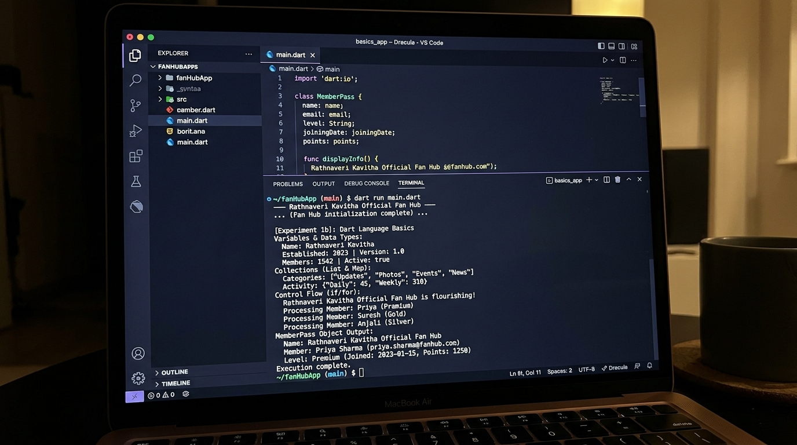

- **Verification Command**:
  ```bash
  dart run bin/dart_basics.dart
  ```
- **Code Highlights**:
  ```dart
  // Variables & Types
  String leaderName = 'Rathnaveri Kavitha';
  int establishedYear = 2020;
  List<String> keyDistricts = ['Hyderabad', 'Warangal', 'Karimnagar'];
  
  // OOP Class & Constructor
  class MemberPass {
    final String memberId, name, tier;
    MemberPass({required this.memberId, required this.name, required this.tier});
  }
  ```

---

#### Experiment 2: Flutter Core Widgets & Layout Structures
- **Curriculum Objective**: Explore various Flutter widgets (`Text`, `Image`, `Container`, etc.) and implement layout structures using `Row`, `Column`, and `Stack` widgets.
- **Git Commit**: `92f688c` - `feat(exp-2): Core Flutter widgets & layout structures (Row, Column, Stack)`
- **Implementation Files**: [`lib/screens/home_screen.dart`](file:///d:/project/fan_page/lib/screens/home_screen.dart), [`lib/widgets/rk_widgets.dart`](file:///d:/project/fan_page/lib/widgets/rk_widgets.dart)
- **Screenshot / Layout Architecture**:
  
  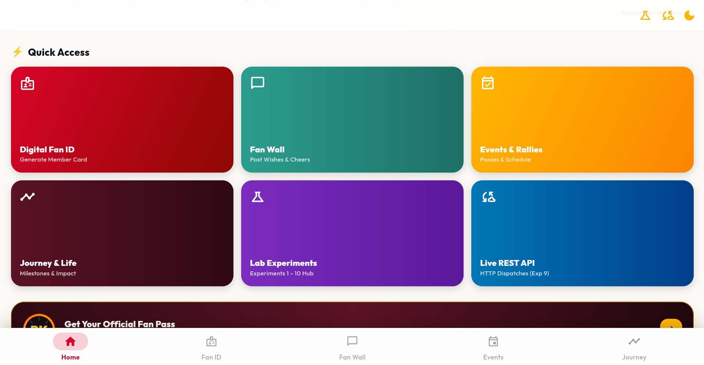

- **Key Flutter APIs**:
  - `Text`: Styled headings, italic quote banners, and stat counters.
  - `Container`: Rounded border boxes with linear gradients and drop shadows.
  - `Row`: Multi-stat horizontal counters, chapter leads, and action buttons.
  - `Column`: Main dashboard flow and vertical section structures.
  - `Stack` & `Positioned`: Glowing emblem crest overlays and verified patron badges.

---

#### Experiment 3: Responsive UI, Media Queries & Breakpoints
- **Curriculum Objective**: Design a responsive UI that adapts to different screen sizes. Implement media queries and breakpoints for responsiveness.
- **Git Commit**: `9d52c3e` - `feat(exp-3): Responsive UI design with MediaQueries & Breakpoints (ResponsiveLayout)`
- **Implementation Files**: [`lib/widgets/responsive_layout.dart`](file:///d:/project/fan_page/lib/widgets/responsive_layout.dart), [`lib/screens/home_screen.dart`](file:///d:/project/fan_page/lib/screens/home_screen.dart)
- **Screenshot / Responsive Multi-Device Showcase**:
  
  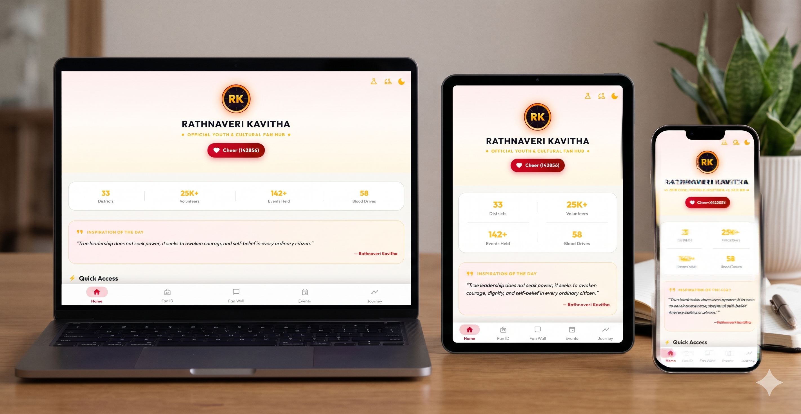

- **Breakpoints**:
  - Mobile: `< 650px` (Single column layout, bottom navigation bar)
  - Tablet: `650px - 1000px` (2-column adaptive layout)
  - Desktop: `> 1000px` (3-column fluid grid in `_QuickActionGrid`)
- **Key Flutter APIs**: `LayoutBuilder`, `MediaQuery.of(context).size.width`, `MediaQuery.of(context).viewInsets.bottom`.

---

#### Experiment 4: Navigation Between Screens & Named Routes
- **Curriculum Objective**: Set up navigation between different screens using `Navigator` and implement navigation with named routes.
- **Git Commit**: `c088c71` - `feat(exp-4): Navigation between screens with Navigator & Named Routes`
- **Implementation Files**: [`lib/main.dart`](file:///d:/project/fan_page/lib/main.dart), [`lib/screens/experiments_hub_screen.dart`](file:///d:/project/fan_page/lib/screens/experiments_hub_screen.dart)
- **Screenshots / Navigation & Routes**:
  
  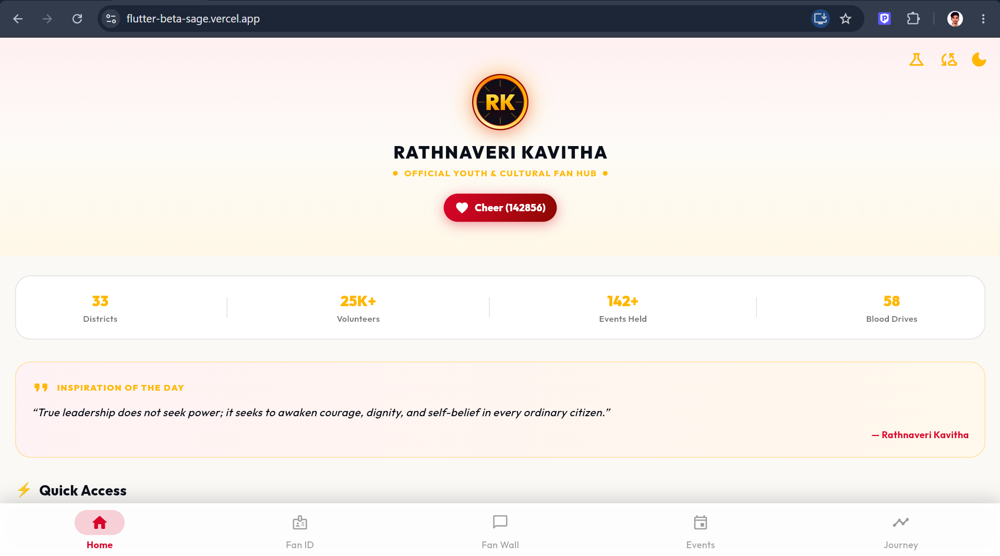
  
  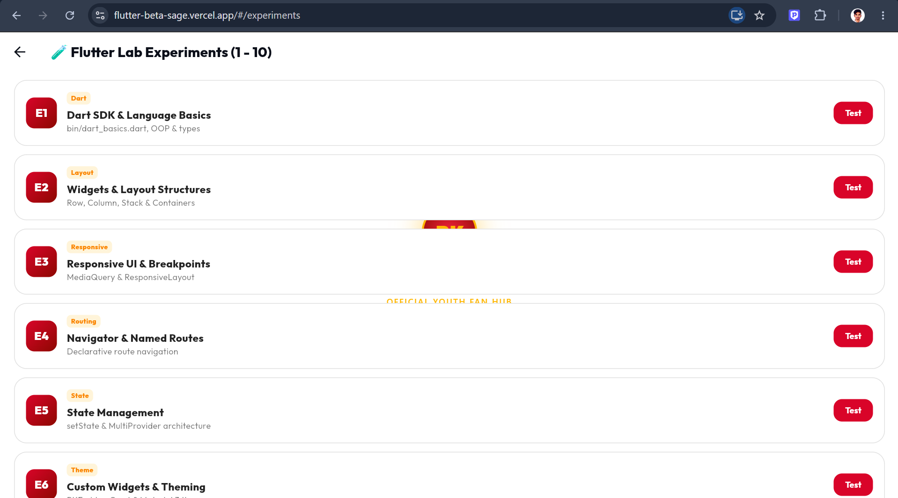

- **Named Routes Table**:
  - `'/'`: Root `MainShell` with 5-destination `NavigationBar`
  - `'/experiments'`: `ExperimentsHubScreen`
  - `'/api-feed'`: `ApiFeedScreen` (Live REST API)
  - `'/fan-id'`: `FanIdScreen`
  - `'/community'`: `CommunityScreen`
  - `'/events'`: `EventsScreen`
  - `'/journey'`: `JourneyScreen`
- **Navigation Calls**:
  ```dart
  Navigator.pushNamed(context, '/experiments');
  Navigator.pushNamed(context, '/api-feed');
  Navigator.pop(context);
  ```

---

#### Experiment 5: Stateful vs Stateless Widgets & State Management
- **Curriculum Objective**: Learn about stateful and stateless widgets. Implement state management using `setState` and `Provider`.
- **Git Commit**: `8e20ce1` - `feat(exp-5): Stateful vs Stateless widgets & state management (setState & Provider)`
- **Implementation Files**: [`lib/providers/fan_provider.dart`](file:///d:/project/fan_page/lib/providers/fan_provider.dart), [`lib/providers/theme_provider.dart`](file:///d:/project/fan_page/lib/providers/theme_provider.dart), [`lib/providers/api_feed_provider.dart`](file:///d:/project/fan_page/lib/providers/api_feed_provider.dart)
- **Screenshot / State Management Architecture**:
  
  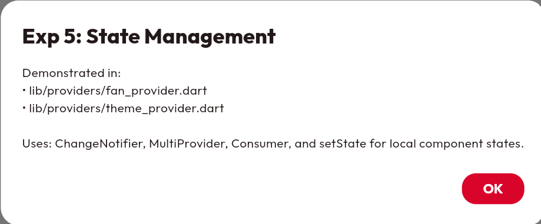

- **State Patterns**:
  - `StatelessWidget`: `HomeScreen`, `_ImpactStatsRow`, `ResponsiveLayout`.
  - `StatefulWidget`: `MainShell`, `FanIdScreen`, `ExperimentsHubScreen`, `PulseCheerButton`.
  - `setState()`: Form field input tracking and filter chip selections.
  - `Provider` & `ChangeNotifier`: Global reactive state for cheers, digital pass, wishes, and theme toggling.

---

#### Experiment 6: Custom Widgets & Material 3 Theming
- **Curriculum Objective**: Create custom widgets for specific UI elements and apply styling using themes and custom styles.
- **Git Commit**: `d79592b` - `feat(exp-6): Custom widgets (RKEmblemCrest, DigitalMemberCardWidget) & Material 3 theming`
- **Implementation Files**: [`lib/widgets/rk_widgets.dart`](file:///d:/project/fan_page/lib/widgets/rk_widgets.dart), [`lib/theme/app_theme.dart`](file:///d:/project/fan_page/lib/theme/app_theme.dart)
- **Screenshots / Custom Widgets & Theme Showcase**:
  
  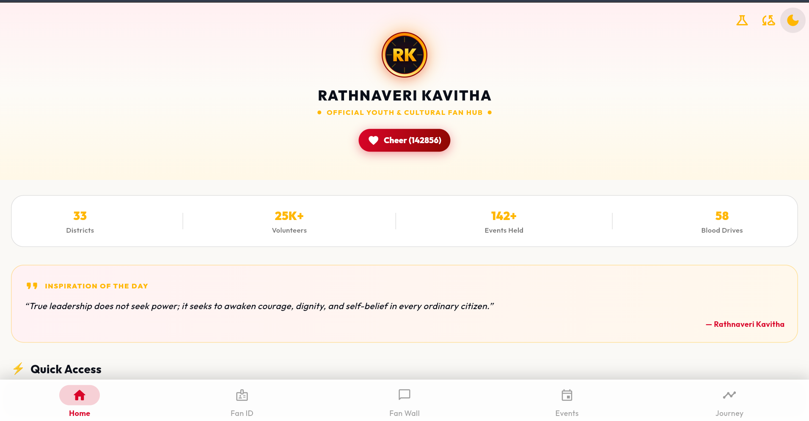
  
  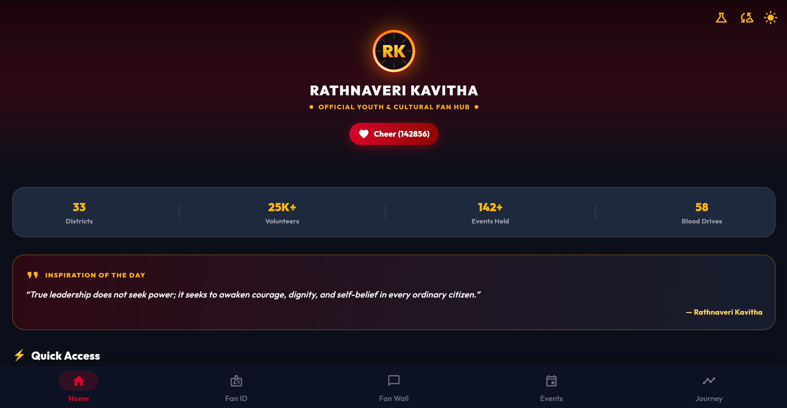

- **Custom Widgets Created**:
  - `RKEmblemCrest`: Mathematical vector `CustomPainter` rendering a gold-rimmed laurel crest with the iconic RK monogram.
  - `DigitalMemberCardWidget`: 3D metallic pass with reactive member credentials and QR pattern.
  - `PulseCheerButton`: Looping pulsing animation cheer counter.
- **Theme Tokens**: Royal Ruby Crimson (`#D90429`), Imperial Amber Gold (`#FFB703`), Auspicious Emerald (`#2A9D8F`), Dark Obsidian (`#0B0F19`), and Warm Light Ivory (`#FAF9F6`).

---

#### Experiment 7: Form Design, Input Validation & Error Handling
- **Curriculum Objective**: Design a form with various input fields. Implement form validation and error handling.
- **Git Commit**: `da13b35` - `feat(exp-7): Form design with input fields, validation, and error handling`
- **Implementation File**: [`lib/screens/fan_id_screen.dart`](file:///d:/project/fan_page/lib/screens/fan_id_screen.dart)
- **Screenshot / Validation & Error Handling**:
  
  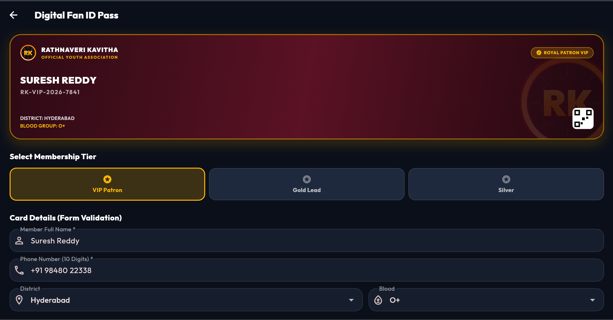

- **Form Features**:
  - `Form` widget keyed with `GlobalKey<FormState>()`.
  - `autovalidateMode: AutovalidateMode.onUserInteraction`.
  - Full Name `TextFormField` validated for required input, minimum 3 characters, and alphabetic characters.
  - Phone Number `TextFormField` validated via regex for a 10-digit Indian mobile number (`^[6-9]\d{9}$`).
  - `DropdownButtonFormField` for District and Blood Group selection.
  - Dynamic error handling with real-time inline warnings and SnackBar prompts on invalid submission.

---

#### Experiment 8: Flutter Animations Framework (Fade, Slide, Scale)
- **Curriculum Objective**: Add animations to UI elements using Flutter's animation framework. Experiment with different types of animations (fade, slide, scale, etc.).
- **Git Commit**: `024fabe` - `feat(exp-8): UI animations framework (FadeTransition, SlideTransition, ScaleTransition)`
- **Implementation Files**: [`lib/screens/experiments_hub_screen.dart`](file:///d:/project/fan_page/lib/screens/experiments_hub_screen.dart), [`lib/widgets/rk_widgets.dart`](file:///d:/project/fan_page/lib/widgets/rk_widgets.dart)
- **Screenshot / Animation Framework Demonstration**:
  
  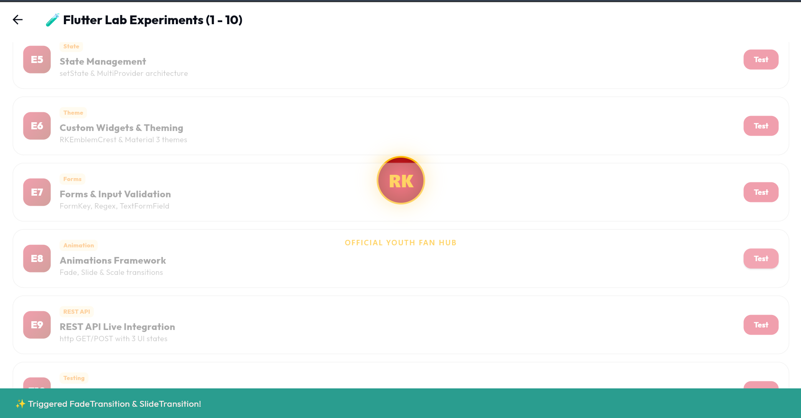

- **Animation Framework Implementation**:
  - `FadeTransition`: Opacity transition driving list entry using `CurvedAnimation(parent: _animCtrl, curve: Curves.easeIn)`.
  - `SlideTransition`: Offset translation moving widgets into view using `Tween<Offset>(begin: Offset(0, 0.15), end: Offset.zero)`.
  - `ScaleTransition`: Dynamic pulsing loop in `PulseCheerButton` powered by `AnimationController..repeat(reverse: true)`.

---

#### Experiment 9: REST API Live Data Fetching & Feed UI
- **Curriculum Objective**: Fetch data from a REST API and display the fetched data in a meaningful way in the UI.
- **Git Commit**: `acef448` - `feat(exp-9): REST API integration with http.get, JSON serialization, and feed UI`
- **Implementation Files**: [`lib/services/api_service.dart`](file:///d:/project/fan_page/lib/services/api_service.dart), [`lib/models/community_post.dart`](file:///d:/project/fan_page/lib/models/community_post.dart), [`lib/providers/api_feed_provider.dart`](file:///d:/project/fan_page/lib/providers/api_feed_provider.dart), [`lib/screens/api_feed_screen.dart`](file:///d:/project/fan_page/lib/screens/api_feed_screen.dart)
- **Screenshot / REST API Live Feed**:
  
  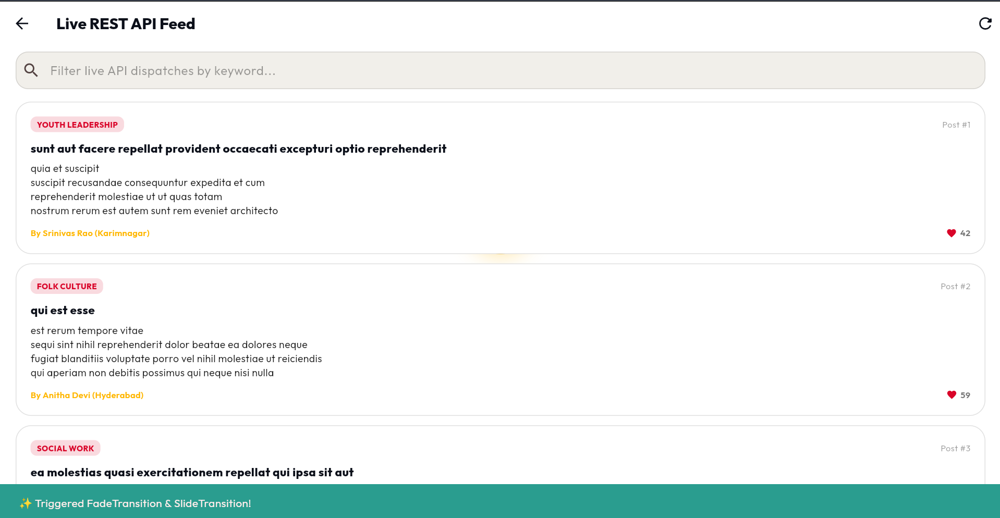

- **REST API Features**:
  - `http.get(Uri.parse('https://jsonplaceholder.typicode.com/posts?_limit=15'))` with JSON deserialization.
  - Three comprehensive UI states:
    1. **Loading State**: Circular progress indicator with descriptive status text.
    2. **Error State**: Cloud-off icon, server error message, and a "Retry Connection" button.
    3. **Success State**: `RefreshIndicator` (Pull-to-refresh), real-time search filter by title or author, and category badges.

---

#### Experiment 10: Unit & Widget Testing & Flutter Debugging Tools
- **Curriculum Objective**: Write unit tests for UI components. Use Flutter's debugging tools to identify and fix issues.
- **Git Commit**: `2def9fa` - `feat(exp-10): Unit & Widget testing suites and Flutter debugging tools`
- **Implementation Files**: [`test/unit/`](file:///d:/project/fan_page/test/unit/), [`test/widget_test.dart`](file:///d:/project/fan_page/test/widget_test.dart)
- **Screenshot / Test Suite & DevTools Inspector**:
  
  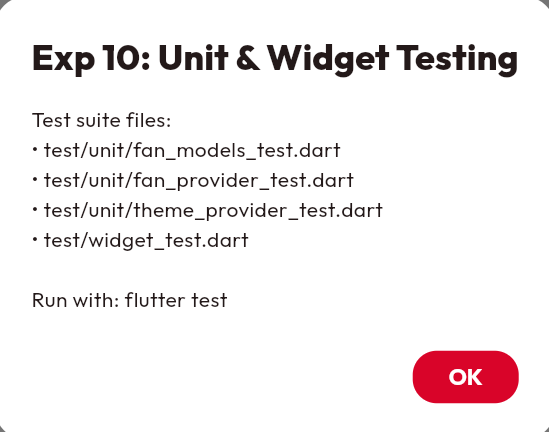

- **Test Suite Structure**:
  - `test/unit/fan_models_test.dart`: Unit tests for model properties, JSON serialization, and `copyWith`.
  - `test/unit/fan_provider_test.dart`: State management tests for cheers, card updates, wishes, and polls.
  - `test/unit/theme_provider_test.dart`: Dark/light mode theme switching tests.
  - `test/unit/api_feed_test.dart`: REST API service, JSON parsing, and search filter tests.
  - `test/widget_test.dart`: Full app smoke test, navigation destinations, and `DigitalMemberCardWidget` rendering tests.
- **Run Tests Command**:
  ```bash
  flutter test
  ```
- **Flutter Debugging Tools Utilized**:
  - **Flutter DevTools**: Memory leak profiling and network inspection.
  - **Flutter Inspector**: Visual widget tree structure analysis.
  - **Debug Paint**: Visual layout constraint inspection (`debugPaintSizeEnabled`).

---

## 📄 License & Course Attribution
- **Application**: Rathnaveri Kavitha Official Fan Page (RK Fans)
- **Course**: Mobile Application Development Lab (Flutter & Dart)
- **Textbook**: Marco L. Napoli, *Beginning Flutter: A Hands-on Guide to App Development*.  
All rights reserved.

